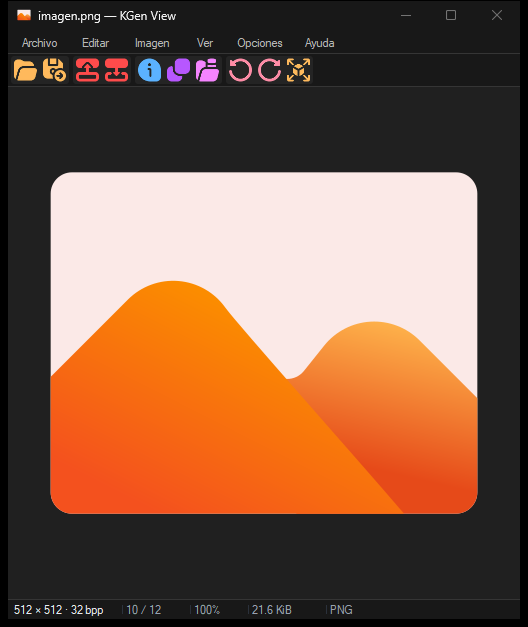

# KGen View

<p align="center">
  
</p>

<p align="center">
  Visor de imágenes nativo para Windows, rápido, compacto y sin distracciones.
</p>

<p align="center">
  
  
  
</p>

<p align="center">
  
</p>

KGen View es un visor de imágenes para Windows 10 y 11 de 64 bits. Está construido como una aplicación Win32 nativa en Rust, con decodificación mediante Windows Imaging Component (WIC) y renderizado acelerado con Direct2D. El resultado es una herramienta pequeña, directa y cómoda para abrir imágenes, recorrer carpetas y hacer ajustes rápidos sin convertir el visor en un editor pesado.

## Características

- Interfaz nativa, compacta y adaptada a pantallas con escalado DPI.
- Modo oscuro, modo claro y seguimiento del tema del sistema.
- Cambio de idioma entre español e inglés.
- Arrastrar y soltar, apertura desde el Explorador y apertura por línea de comandos.
- Navegación circular por las imágenes de la carpeta, con orden natural para nombres como `imagen2.png` e `imagen10.png`.
- Apertura de archivos ZIP y CBZ: indexado rápido y extracción bajo demanda mientras se navega por las imágenes.
- Al abrir desde el Explorador una imagen dentro de un ZIP, carga el archivo completo y se sitúa en esa imagen.
- Redimensionado automático de la ventana para aprovechar el espacio disponible.
- Zoom con rueda, zoom libre, tamaño real, ajuste a ventana y ajuste al ancho.
- Paneo y pantalla completa.
- GIF animado y navegación por fotogramas o páginas en documentos multipágina compatibles.
- Rotación de 90°, volteo horizontal y vertical, recorte de selección y deshacer/rehacer.
- Conversión desde **Editar → Convertir formato** a los formatos que Windows tenga disponibles para exportar.
- Panel de conversión flotante, con tema a juego y estado animado durante la exportación.
- Varias instancias independientes para abrir imágenes en ventanas separadas, también desde el Explorador.
- Opción **Ver → Siempre encima** para mantener la ventana activa sobre las demás aplicaciones.
- Guardar como con los codificadores de imagen detectados en Windows Imaging Component (WIC).
- Copiar la imagen o su ruta al portapapeles.
- Actualizaciones desde GitHub: la instalación comprueba versiones al iniciar y muestra un botón para descargar e instalar la publicación más reciente.
- Captura rectangular opcional con atajo global; copia la imagen y la guarda en `Imagenes\KGen` con autor de Windows, fecha UTC, titulo, descripcion y datos de KGen View en el PNG.
- Envío a la Papelera de reciclaje con confirmación configurable.
- Presentación con intervalo configurable.
- Salto automático de archivos dañados o incompatibles durante la navegación.
- Sin telemetría ni WebView; el proceso residente de captura solo se inicia al activar esa función.

## Formatos

### Apertura

KGen View abre directamente los siguientes formatos:

| Formato | Extensiones |
|---|---|
| Bitmap | `.bmp`, `.dib` |
| JPEG | `.jpg`, `.jpeg`, `.jpe` |
| PNG | `.png` |
| GIF | `.gif` |
| TIFF | `.tif`, `.tiff` |
| Iconos | `.ico` |
| WebP | `.webp` |
| HEIF / HEIC | `.heif`, `.heic` |
| JPEG XL | `.jxl` |
| SVG | `.svg` |
| Otros codecs WIC | `.wdp`, `.jxr`, `.hdp`, `.dds`, si el codec está disponible en Windows |
| Archivos de imágenes | `.zip`, `.cbz` (imágenes compatibles dentro del archivo) |

WebP y HEIF/HEIC dependen de los codecs instalados en Windows. JPEG XL se decodifica dentro de KGen View, sin necesitar un codec adicional del sistema. La aplicación muestra un aviso cuando falta un codec necesario para WebP o HEIF/HEIC.

### Exportación

En **Editar → Convertir formato**, elige uno de los formatos que Windows tiene disponibles mediante WIC en ese equipo. La lista puede incluir PNG, JPEG, BMP, TIFF, GIF, JPEG XR y otros formatos si hay un codificador instalado. La ventana permite guardar una copia sin cambiar el archivo abierto y muestra una animación mientras se convierte. En imágenes animadas o documentos multipágina se exporta el fotograma visible.

La opción **Guardar como** también ofrece los codificadores disponibles y conserva su comportamiento habitual: la imagen abierta pasa a usar el archivo guardado.

## Atajos de teclado

Activa **Opciones -> Activar captura rectangular** para habilitar la captura. Cada seleccion se copia como imagen al portapapeles y se guarda como PNG en la carpeta conocida **Imagenes\KGen** de Windows. Al terminar, KGen muestra una notificacion de Windows y reproduce el sonido de sistema. El marco cuadrado de 1 px usa dibujo GDI nativo; `Esc` cancela. En **Opciones -> Cambiar atajo de captura** puedes elegir otra combinacion, incluida la tecla Windows; **Iniciar capturas con Windows** es una opcion separada y esta desactivada inicialmente. El capturador residente no usa sondeo periodico. Si cierras KGen View mientras esta activo, el capturador permanece oculto; vuelve a abrir KGen View y desactivalo desde **Opciones** para detenerlo.

| Acción | Atajo |
|---|---|
| Abrir imagen | `Ctrl + O` |
| Guardar como | `Ctrl + Shift + S` |
| Imagen anterior / siguiente | `←` / `→` |
| Primera / última imagen de la carpeta | `Inicio` / `Fin` |
| Navegar con la rueda | `Rueda del ratón` |
| Acercar / alejar | `Ctrl + rueda`, `+` / `-` |
| Tamaño real | `1` |
| Encajar en la ventana | `F` |
| Recortar la última selección | `Ctrl + Shift + X` |
| Copiar imagen | `Ctrl + C` |
| Deshacer / rehacer | `Ctrl + Z` / `Ctrl + Y` |
| Fotograma o página anterior / siguiente | `RePág` / `AvPág` |
| Pausar o reanudar animación | `Espacio` |
| Presentación | `F5` |
| Recargar imagen | `F9` |
| Captura rectangular (si esta activada) | `Ctrl + Win + Z` (configurable) |
| Pantalla completa | `F11` |
| Salir de pantalla completa | `Esc` |
| Enviar a la Papelera | `Supr` |
| Información de la imagen | `I` |

## Instalación

Las instalaciones hechas con el instalador comprueban GitHub al abrirse. Cada subida a `main` publica una beta que se ofrece a todos; las etiquetas `vX.Y.Z` publican versiones estables. Si hay una versión nueva, pulsa el botón de descarga de la barra para descargarla y aplicarla. La app verifica el SHA-256 antes de abrir el instalador. La versión portable se actualiza descargando su ejecutable desde GitHub.

La forma recomendada para distribuir KGen View es el instalador `KGenView-Setup-x64.exe`. El instalador no necesita permisos de administrador: se instala en el perfil del usuario y puede registrar las asociaciones de archivos para BMP, JPEG, PNG, GIF, TIFF, ICO, WebP, HEIF/HEIC, SVG, ZIP y CBZ.

Si estás usando una compilación local, el script de release genera estos archivos en `dist\`:

```text
dist\KGenView.exe
dist\KGenView-Setup-x64.exe
```

También puedes ejecutar `KGenView.exe` como versión portable sin instalarlo.

## Compilación desde el código fuente

### Requisitos

- Windows 10 u 11 de 64 bits.
- Rust estable con el target MSVC de 64 bits.
- Visual Studio Build Tools con las herramientas de C++ y el Windows SDK.
- Inno Setup 6 para generar el instalador.

La compilación de desarrollo solo necesita Rust y las herramientas de compilación de Windows. Inno Setup es necesario únicamente para crear el instalador.

### Ejecutar en desarrollo

```powershell
cargo run --release -- "C:\ruta\a\una\imagen.png"
```

Sin una ruta inicial, la aplicación se abre vacía y puedes cargar una imagen mediante el menú o arrastrándola a la ventana.

### Crear una release

GitHub Actions compila cada push a `main` y publica una beta. Para publicar una versión estable, actualiza `version` en `Cargo.toml`, crea la etiqueta correspondiente (`vX.Y.Z`) y súbela a GitHub. La etiqueta debe coincidir con la versión del proyecto; la publicación incluye el instalador, el ejecutable portable y los hashes SHA-256.

```powershell
.\scripts\build-release.ps1
```

El script ejecuta el formateador, Clippy y las pruebas antes de compilar la versión optimizada. Después copia el ejecutable a `dist\` y compila el instalador con Inno Setup.

Para firmar los artefactos de forma opcional, define estas variables de entorno antes de ejecutar el script:

```powershell
$env:KGEN_SIGN_CERT = "C:\ruta\certificado.pfx"
$env:KGEN_SIGN_PASSWORD = "tu-contraseña"
.\scripts\build-release.ps1
```

La firma requiere `signtool.exe`, incluido en el Windows SDK.

## Privacidad y red

KGen View no recopila telemetría. En cada inicio, las instalaciones verifican las versiones publicadas en GitHub mediante HTTPS; al descargar una actualización, la app comprueba su SHA-256 antes de abrir el instalador. Tras actualizar, Windows vuelve a abrir cada instancia con su imagen actual; si estaba abierta una imagen de ZIP/CBZ, restaura también el archivo y miembro. El actualizador no descarga ni ejecuta un instalador cuyo hash no coincida. Como todavía no hay un certificado Authenticode, el hash comprueba la integridad respecto al manifiesto publicado, pero no autentica por separado al editor. La app también usa la red cuando se selecciona **Copiar enlace directo (ImgBB)**.

Esta función necesita una clave API de ImgBB, que se configura desde **Información de imagen**. Al usarla, el archivo original se envía a `api.imgbb.com` mediante HTTPS y el enlace directo resultante se copia al portapapeles. ImgBB limita la subida a imágenes de hasta 32 MiB.

La configuración de la aplicación —incluida la clave de ImgBB— se guarda por usuario en el Registro de Windows, bajo:

```text
HKEY_CURRENT_USER\Software\KGenView
```

Si no necesitas compartir imágenes, puedes ignorar esta función y KGen View seguirá funcionando sin conexión.

## Control con IA mediante MCP

KGen View incluye un servidor [MCP](https://modelcontextprotocol.io/) local por **stdio**. Permite que un cliente MCP compatible controle una ventana dedicada de KGen View. No se inicia con el uso normal: el cliente debe lanzarlo expresamente con `--mcp`, por lo que no abre puertos ni añade tráfico de red.

Configura el cliente MCP para ejecutar el binario de KGen View con ese argumento. Por ejemplo, en clientes que usan `mcpServers`:

```json
{
  "mcpServers": {
    "kgen-view": {
      "command": "C:\\ruta\\a\\KGenView.exe",
      "args": ["--mcp"]
    }
  }
}
```

El cliente inicia una instancia de KGen View para esa sesión MCP. Las herramientas permiten consultar el estado, abrir una imagen por ruta absoluta, navegar por la carpeta o los fotogramas, ajustar la vista, alternar presentación o animación, aplicar rotaciones y volteos, y deshacer/rehacer. `convert_image` exporta una copia en un formato instalado en Windows; indica `output_path` y `format` (por ejemplo, `PNG`). La conversión se ejecuta en segundo plano, conserva abierta la imagen original y no sobrescribe un destino existente. No se exponen borrado, subida a ImgBB ni guardado automático de la imagen abierta. El cliente de IA puede recibir la ruta local y los metadatos de la imagen actual.

En el uso normal, sin `--mcp`, no se inicia el hilo MCP ni se enumeran formatos para esta función. La conversión solo se prepara tras una llamada MCP y usa el trabajador de operaciones de archivo ya existente; el hilo de interfaz sigue libre para dibujar y responder.

Como con cualquier servidor MCP, concede acceso solo a clientes de confianza: estos pueden solicitar la apertura de archivos locales y realizar las acciones enumeradas mientras la sesión esté activa.

## Arquitectura y rendimiento

KGen View mantiene una interfaz Win32 y renderizado Direct2D. La ventana coordina servicios de carga, catálogo, vigilancia de carpetas y operaciones de archivo; sus implementaciones son módulos Rust con visibilidad explícita.

- **Carga progresiva:** abre una vista ajustada y solicita detalle de la región visible al ampliar. JPEG aprovecha la reducción nativa de WIC cuando está disponible. Las dimensiones mostradas siguen siendo las originales.
- **Páginas bajo demanda:** TIFF carga una página cada vez. GIF conserva el estado de composición y una caché limitada de fotogramas, sin expandir toda la animación en RAM.
- **Edición geométrica:** rotación, volteo y recorte se almacenan como operaciones; deshacer/rehacer conserva instrucciones en lugar de copias completas. Guardar y convertir usan la resolución original.
- **Trabajo en segundo plano:** carga, precarga, catálogo, guardado, preparación del portapapeles, renombrado, Papelera y limpieza de ZIP. Los resultados tienen propiedad explícita en buzones acotados.
- **Renderizado:** texturas divididas en bloques y reutilizadas entre fotogramas compatibles; el repintado se produce por eventos. Minimizar pausa animación, presentación y precarga y libera cachés de presentación.
- **Carpetas:** listas compartidas con búsqueda indexada y notificaciones de cambios; la comprobación periódica queda como alternativa cuando Windows no permite vigilar la carpeta.
- **ZIP/CBZ:** lectores reutilizados por trabajador, extracción bajo demanda y referencias que mantienen los temporales vivos mientras los usan el visor o una exportación.

El presupuesto por proceso permite reservar hasta **512 MiB de buffers CPU controlados** y **64 MiB de texturas de imagen**. La vista previa se limita a 32 MiB, la precarga a 16 MiB y la caché de fotogramas GIF a 32 MiB, subordinadas al presupuesto CPU común. Los códecs, Direct2D y sus controladores pueden realizar asignaciones internas adicionales: estos valores no son un límite absoluto de memoria del proceso.

Se conservan los límites de dimensiones de 100.000 × 100.000 píxeles, 512 páginas/fotogramas y 64 MiB de entrada SVG. La exportación devuelve un error cuando no puede conservar la resolución original dentro de los límites; no reduce silenciosamente el archivo guardado. JPEG XL usa hasta dos hilos de decodificación.

Consulta [docs/performance.md](docs/performance.md) para reproducir mediciones, revisar las decisiones de arquitectura y ejecutar las comprobaciones de calidad.

## Licencia

KGen View se distribuye bajo la licencia MIT. Consulta [LICENSE](LICENSE) para ver el texto completo.
