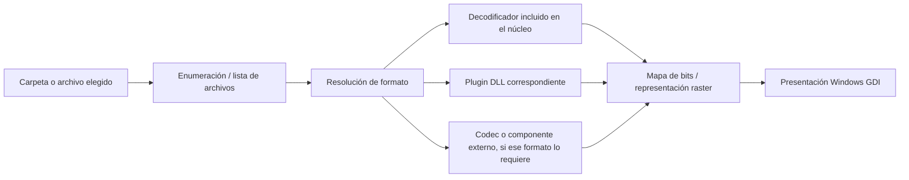

# Informe técnico: por qué IrfanView parece abrir imágenes tan rápido

**Fecha del análisis:** 5 de noviembre de 2026  
**Equipo:** instalación local de IrfanView para Windows, 64 bits  
**Archivo examinado:** `C:\Program Files\IrfanView\i_view64.exe`  
**Tipo de revisión:** inspección estática del ejecutable, tabla de importaciones PE, DLL de plugins instaladas, exportaciones visibles y documentación oficial. No es una auditoría de seguridad ni una medición de rendimiento.

## Conclusión ejecutiva

La explicación mejor respaldada es que IrfanView separa tres trabajos que suelen confundirse: enumerar los nombres de una carpeta, decodificar la imagen que se solicita y dibujar el resultado en la ventana. El ejecutable principal es pequeño (2,43 MiB), es un programa Win32 nativo de 64 bits y no depende de un runtime general como .NET. Su tabla de importaciones contiene API de Windows para enumerar archivos, leerlos, cargar DLL dinámicamente y presentar mapas de bits. Los formatos especiales se distribuyen en plugins separados, varios de los cuales exportan funciones explícitas `Read...` y `GetPlugInInfo`.

Por tanto, no hace falta que el programa convierta todas las imágenes de una carpeta a píxeles antes de enseñar la primera. La lista de carpeta puede construirse con metadatos de archivos, y la decodificación completa puede realizarse para el elemento que se abre. La página oficial confirma que ciertas operaciones de listado sí fuerzan lectura de cabeceras: ordenar por fecha EXIF puede ralentizar la actualización de la primera imagen. Esta arquitectura explica la sensación de rapidez mejor que la idea de que exista un único decodificador universal instantáneo.

**Límite clave:** no se midieron tiempos ni se capturó la carga de módulos en ejecución. El intento de observar la interfaz se detuvo con Escape físico. Las afirmaciones sobre el momento exacto en que se cargan los plugins y sobre la ruta interna de cada decodificador quedan como inferencias, no como hechos observados en tiempo de ejecución.

## 1. Qué se inspeccionó

1. Metadatos PE, tamaño, firma Authenticode y SHA-256 del ejecutable principal.
2. Tabla de imports del ejecutable con GNU `objdump`: DLL de Windows, funciones importadas y secciones PE.
3. Archivos de `C:\Program Files\IrfanView\Plugins`: conteo, tamaños, versiones y exports de una muestra de plugins.
4. Documentación distribuida con la instalación: `i_about.txt`, `i_plugins.txt`, `i_options.txt` y `Plugins\Readme_install.txt`.
5. Páginas oficiales de formatos, plugins, preguntas frecuentes e historial de IrfanView; documentación Win32 de Microsoft para las API identificadas.

No se abrieron ni se enumeraron carpetas personales de imágenes. No se encontró código fuente del producto en la carpeta de instalación; por eso el análisis de “código” se limita a estructura y símbolos visibles del binario PE, no a reconstrucción completa de los algoritmos.

## 2. Evidencia de la instalación

| Propiedad | Resultado local |
|---|---|
| Producto | IrfanView 64-bit |
| Versión del ejecutable | 4.75.0.0 |
| Arquitectura / formato PE | x86-64, PE32+; subsistema Windows GUI |
| CLR / .NET | Sin directorio CLR en la cabecera PE; imports de Win32 nativo |
| Tamaño del ejecutable principal | 2.547.328 bytes (2,43 MiB) |
| Fecha PE | 14 de mayo de 2026 |
| Firma del ejecutable | Authenticode válida; firmante Irfan Skiljan |
| SHA-256 del ejecutable | `2EF930CAC265A2D8CB890C37DF2DF781354BD3662C3D183F934E8050FB96C655` |
| Directorio Plugins | 53 archivos: 48 DLL, 3 EXE, 1 JPAC y 1 TXT |
| Tamaño acumulado de Plugins | 62,54 MiB |
| Tamaño de toda la carpeta de instalación | 75,17 MiB |

El historial oficial fija el lanzamiento de 4.75 el 15 de mayo de 2026. La página oficial consultada el día de este informe ya anuncia 4.76, por lo que la copia local no es la última disponible en esa fecha. Esto no demuestra por sí mismo que la instalación falle con algún formato; sí importa al comparar versiones y plugins.

## 3. Qué revela el ejecutable

### 3.1 Dependencias del núcleo

El ejecutable importa funciones de seis DLL de Windows: `KERNEL32.dll`, `USER32.dll`, `GDI32.dll`, `ADVAPI32.dll`, `SHELL32.dll` y `COMCTL32.dll`. La lista examinada contiene 440 nombres de funciones importadas. Entre ellas:

| Trabajo | Imports observados en `i_view64.exe` | Qué permite inferir |
|---|---|---|
| Enumeración de archivos | `FindFirstFileExW`, `FindFirstFileW`, `FindNextFileW`, `FindClose` | El binario incorpora la API clásica de Windows para recorrer coincidencias de archivos. La API, por sí sola, no prueba qué ruta usa IrfanView en cada pantalla. |
| Carga modular | `LoadLibraryW`, `LoadLibraryExW`, `GetProcAddress`, `FreeLibrary`, `SetDllDirectoryW` | El ejecutable puede cargar módulos DLL en tiempo de ejecución y resolver exports por nombre. Microsoft documenta `LoadLibraryEx` para cargar un módulo y `GetProcAddress` para resolver una función exportada. |
| Entrada/salida | `CreateFileW`, `ReadFile`, `GetFileSizeEx`, `SetFilePointerEx`, `CreateFileMappingA`, `MapViewOfFile` | Hay rutas disponibles de lectura convencional y mapeo de archivos en memoria. El import table no indica cuál se utiliza para cada tipo de imagen. |
| Presentación de píxeles | `CreateDIBitmap`, `GetDIBits`, `SetDIBits`, `SetDIBitsToDevice`, `StretchDIBits`, `BitBlt`, `StretchBlt` | La ruta de salida incluye las API clásicas de mapas de bits/GDI. No es evidencia de decodificación por GPU. |
| Interfaz | `CreateWindowExW`, `DispatchMessageW`, `CreateDialogParamW`, controles comunes de Windows | Interfaz de escritorio Win32; no se observa un framework de UI pesado en las importaciones directas. |

`StretchDIBits` puede copiar y escalar datos de un DIB a un rectángulo de destino. Su presencia encaja con una ruta en la que un decodificador produce píxeles y el programa los presenta en la ventana, pero no permite determinar el algoritmo de escalado que se aplica en cada modo.

### 3.2 Plugins: formatos añadidos sin agrandar el núcleo

Los plugins están en un directorio separado y la documentación local describe módulos individuales. La página oficial también marca con asterisco los formatos que requieren plugin. La tabla de exports PE aporta evidencia concreta del contrato entre host y plugin:

| DLL instalada | Exports observados | Lectura técnica |
|---|---|---|
| `Avif.dll` | `GetPlugInInfo`, `ReadAVIF_W`, `SaveAVIF_W`, `ShowPlugInOptions_W`, `ShowPlugInSaveOptions_W` | Entrada declarada para consultar el plugin, leer AVIF y guardar AVIF. |
| `CamRAW.dll` | `GetPlugInInfo`, `RAW_GetThumbInfos_W`, `ReadCam_RAW_W` | El módulo RAW separa una entrada para información de miniatura y otra para lectura RAW; el nombre es evidencia de interfaces distintas, no de su algoritmo exacto. |
| `Formats.dll` | 42 exports; entre ellos `ReadPCX_W`, `ReadDDS_W`, `Read_QOI_W`, `ReadXBM_W`, `ReadXPM_W`, `ReadFITS_W`, `ReadTTF_W` y `GetPlugInInfo` | Un módulo cubre muchos formatos raros. No se necesita una DLL independiente por extensión. |
| `WebP.dll` | `ReadWebP_W`, `ReadAnimatedWebP_W`, `SaveWebP_W`, `ScanWEBP_W`, `GetPlugInInfo` | Lectura estática y animada expuestas como operaciones del mismo plugin. |

Los imports `LoadLibrary*` y `GetProcAddress` confirman que el ejecutable puede usar carga dinámica. Las funciones de ejemplo confirman un patrón de plugins con exports específicos por formato. **No se verificó si IrfanView carga todos esos DLL durante el arranque, al abrir el diálogo de plugins o solo cuando los necesita.** Para resolver ese punto hace falta una captura dinámica de módulos.

### 3.3 Mapa conceptual respaldado por el análisis

Es un **modelo conceptual** construido con la tabla de imports, exports de plugins y documentación del fabricante; no es un diagrama publicado por el autor ni una traza dinámica de ejecución.

## 4. Por qué la navegación normal puede sentirse rápida

### A. Enumerar una carpeta es más barato que decodificar todas sus imágenes

El ejecutable importa las funciones de enumeración de archivos de Windows. Microsoft describe `FindFirstFileEx` y `FindNextFile` como una búsqueda que devuelve datos de coincidencias por nombre; esa búsqueda no ordena los resultados. El ordenamiento posterior y la lectura de metadatos pertenecen a la aplicación.

La FAQ de IrfanView identifica un caso concreto: si hay muchos archivos, o se ordena por fecha EXIF, la primera actualización puede demorarse porque ese criterio necesita leer la cabecera de todos los archivos de la lista. Esto separa la velocidad de “armar la lista/actualizar la barra” de la velocidad de dibujar la imagen abierta. Es la evidencia más clara del propio fabricante sobre el coste de navegación.

La conclusión razonable es que IrfanView no necesita decodificar completamente todos los archivos de la carpeta para permitir la navegación normal. La lectura completa puede concentrarse en el archivo actual. Esto es una inferencia respaldada por el diseño modular y por la explicación de EXIF del fabricante, no una conducta medida en este equipo.

### B. El núcleo ocupa poco y usa APIs del sistema

Un ejecutable de 2,43 MiB con imports directos de Windows puede iniciar su ventana sin cargar el tamaño agregado de todos los decodificadores del ecosistema. La instalación completa pesa 75,17 MiB, pero 62,54 MiB están en el directorio de plugins. El tamaño del EXE no demuestra por sí solo tiempo de arranque, aunque sí explica cómo el programa mantiene un núcleo compacto y amplía sus funciones con módulos separados.

### C. Los decodificadores varían según el formato

Un JPG, BMP o PNG común y un RAW de cámara, PDF, SVG, DICOM o CAD no representan el mismo trabajo. Algunos formatos tienen varios tamaños o páginas, perfiles de color, metadatos, capas, animación o datos comprimidos complejos. La propia FAQ indica que en RAW la opción de preview es la más rápida, half-size es rápida y la lectura a tamaño completo es mucho más lenta. El plugin RAW expone además una función llamada `RAW_GetThumbInfos_W`.

### D. El escalado de la ventana y el formato de salida influyen

Una vez decodificados, los píxeles deben convertirse o copiarse a una superficie de presentación. Las imports GDI muestran que el programa usa operaciones de bitmap y escalado de la plataforma. No se encontró evidencia en esta inspección de que el rendimiento general provenga de GPU, precarga paralela de toda la carpeta o una caché universal de imágenes.

## 5. “Soporta todos los tipos” tiene condiciones

El listado oficial abarca formatos raster comunes, cámaras RAW, vectores/documentos, formatos médicos/industriales y audio/video. El asterisco de la tabla del fabricante significa que se requiere un plugin. La versión de 64 bits no admite automáticamente todos los plugins de 32 bits; el fabricante exige separar las carpetas/arquitecturas. Para algunos formatos también se necesita otro componente: por ejemplo, el plugin PostScript depende de Ghostscript para EPS/PS/PDF, y HEIC/AVIF puede depender de codecs/extensiones instalados en Windows según el plugin utilizado.

En esta instalación se observaron DLL relevantes para AVIF, RAW, DICOM, DjVu, DPX, ECW, EXR, FLIF, JPEG 2000, JPEG-LS, JPEG XL, JPM, MNG, PDF/PostScript, SVG, WebP, WSQ, XCF y formatos antiguos. `Formats.dll` agrupa extensiones como PCX, DDS, QOI, FITS, IFF, SGI y varias históricas. La página oficial contiene la lista completa, incluidas las columnas de lectura/guardado y las marcas de plugin.

Algunas dependencias visibles en plugins son específicas: `Tools.dll` y `Hdp.dll` importan `WindowsCodecs.dll`; `Paint.dll` y `VideoExport.dll` importan GDI+; `Ecw.dll`, `Ftp.dll` y el plugin CAD incluyen imports de red. La tabla de imports no demuestra que esos componentes se carguen al abrir una imagen común; tampoco significa que el núcleo los necesite para JPG/PNG/BMP.

## 6. Versión y plugins encontrados

La instalación examinada es 4.75, mientras la web oficial consultada anuncia IrfanView y plugins 4.76. Versiones locales representativas detectadas:

| Módulo | Versión local |
|---|---:|
| `Avif.dll` | 4.74.0.0 |
| `CamRAW.dll` | 4.75.0.0 |
| `Formats.dll` | 4.75.0.0 |
| `Jpeg_XL.dll` | 4.73.1.0 |
| `JPEG2000.dll` | 4.73.1.0 |
| `PDF.dll` | 4.75.0.0 |
| `WebP.dll` | 4.73.0.0 |
| `Tools.dll` | 4.75.0.0 |

El propio fabricante recomienda mantener la aplicación y los plugins actuales, y no mezclar plugins de 32 bits con IrfanView de 64 bits. La existencia de un archivo plugin demuestra que está instalado, pero no demuestra que todos los codecs externos requeridos estén presentes ni que una extensión esté activada en el filtro de navegación.

### Inventario local de plugins

**DLL (48):** AltaLux, Avif, Awd, B3d, BabaCAD4Image, Burning, CADImage, CamRAW, Dicom, DjVu, Dpx, Ecw, Effects, Email, Exr, FilmSim, Flif, Formats, Ftp, Hdp, Icons, IrfanView Sandbox, Jpeg_LS, Jpeg_XL, JPEG2000, JpegQS, Jpg_transform, JPM, Lcms, Metadata, Mng, MrSID, Ocr, OptiPNG, Paint, PDF, Postscript, PsHost, RegionCapture, Sff, SVG, Tools, Video, VideoExport, WebP, WPG, Wsq y Xcf.

**EXE (3):** `IV_Player.exe`, `Slideshow.exe`, `Stub_Plugin.exe`.  
**Otros (2):** `IrfanView Sandbox.jpac`, `Readme_install.txt`.

## 7. Método claro para verificar el rendimiento real por formato

Para pasar de esta explicación estática a una respuesta cuantitativa en este PC, el experimento debe controlar carpeta, archivos y caché:

1. Crear una carpeta de prueba sintética, en SSD local, con cantidades conocidas (por ejemplo, 100 y 1.000 archivos). Usar imágenes generadas para JPG/PNG/BMP y ejemplos de AVIF/WebP/JXL/RAW solo si los codecs instalados permiten abrirlos. No usar fotos personales.
2. Registrar hardware, versión de Windows, versión del ejecutable y plugins, configuración de color, modo RAW, tamaño de ventana y opción de ordenamiento.
3. Medir por separado: inicio hasta ventana lista; apertura de un único archivo; siguiente/anterior; carga de miniaturas; primera visita a carpeta; y visita repetida. Hacer cinco repeticiones y reportar mediana y percentil 95, separando primera ejecución fría de repeticiones con caché caliente.
4. Repetir el recorrido de carpeta con orden por nombre y por EXIF. El cambio de tiempos y de bytes leídos permite aislar el coste de inspección de cabeceras.
5. Durante las repeticiones, capturar eventos de proceso, módulos DLL, actividad de archivos, CPU y working set con Windows Performance Recorder/Analyzer o Process Monitor. Filtrar por `i_view64.exe` y la carpeta sintética.
6. Comparar si `Avif.dll`, `CamRAW.dll` u otro plugin aparece en la lista de módulos al iniciar, al abrir el formato y al cerrar. Eso responde directamente a la duda de carga anticipada frente a carga bajo demanda.
7. Publicar para cada muestra su extensión real, tamaño en bytes, dimensiones, número de archivos, opciones activas y resultado de la carga; un simple cronómetro sin esto no separa decodificación, EXIF, plugin, almacenamiento y caché.

Este protocolo no se ejecutó en esta revisión: la interacción con la interfaz se detuvo con Escape y no se registraron timings ni módulos residentes. Por eso no se presentan milisegundos inventados.

## 8. Dictamen final

La rapidez observable se explica principalmente por un núcleo Win32 muy pequeño, una división del trabajo entre listado de archivos y decodificación, y un sistema extensible de plugins con funciones de lectura/guardado especializadas. La ruta de dibujo usa API de bitmap de Windows. El fabricante confirma que leer metadatos de todos los archivos puede afectar la primera carga y que el modo de preview RAW evita el coste de desarrollar la imagen completa.

La parte demostrada con mayor precisión es el **diseño de carga modular**: imports del cargador de Windows más exports de plugins como `ReadAVIF_W`, `ReadCam_RAW_W`, `ReadWebP_W` y las múltiples funciones `Read..._W` de `Formats.dll`. La parte que permanece sin medir es cuánto tarda cada etapa en este PC y en qué instante se mapea cada plugin. Para responder eso con exactitud hacen falta la captura dinámica descrita arriba y un corpus reproducible.

## Fuentes primarias

- [Formatos admitidos por IrfanView](https://www.irfanview.com/main_formats.htm) — listado por extensión, lectura/guardado y asterisco de plugin.
- [Plugins de IrfanView](https://www.irfanview.com/plugins.htm) — versiones actuales, arquitectura, dependencia de codecs y propósito de los plugins.
- [FAQ oficial de IrfanView](https://www.irfanview.com/faq.htm) — ordenamiento EXIF, primera carga de carpeta y opciones de velocidad para RAW.
- [Historial oficial de versiones](https://www.irfanview.com/history_old.htm) — fecha y cambios de 4.75.
- [Página oficial de 64 bits](https://www.irfanview.com/64bit.htm) — límites de memoria y comportamiento en imágenes grandes.
- [Microsoft: LoadLibraryExW](https://learn.microsoft.com/en-us/windows/win32/api/libloaderapi/nf-libloaderapi-loadlibraryexw) y [GetProcAddress](https://learn.microsoft.com/en-us/windows/win32/api/libloaderapi/nf-libloaderapi-getprocaddress) — carga de DLL y resolución de exports.
- [Microsoft: FindFirstFileExW](https://learn.microsoft.com/en-us/windows/win32/api/fileapi/nf-fileapi-findfirstfileexw) — enumeración de nombres de archivo.
- [Microsoft: StretchDIBits](https://learn.microsoft.com/en-us/windows/win32/api/wingdi/nf-wingdi-stretchdibits) — copia/escalado de píxeles DIB en GDI.
